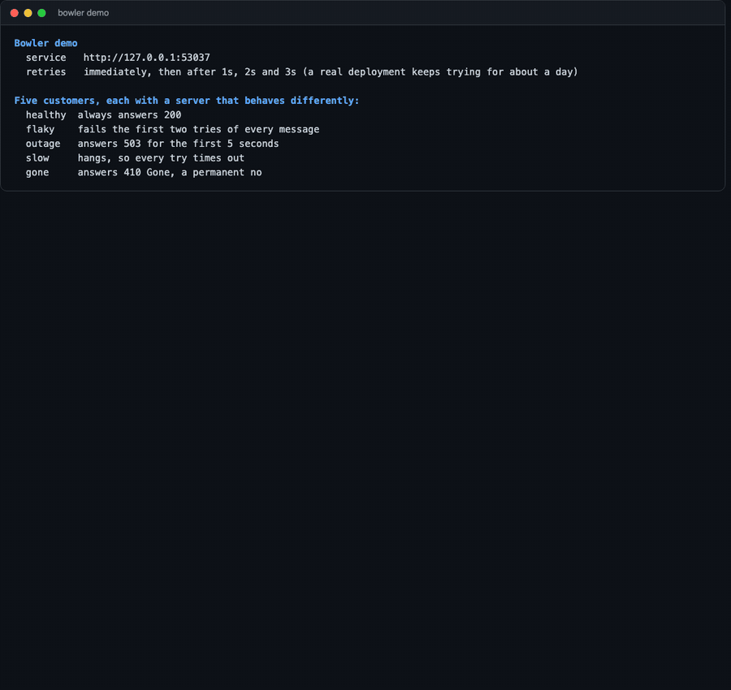
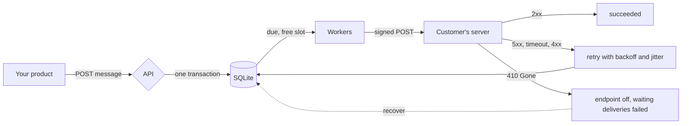

# Bowler

[](https://github.com/sungwoonpk/Bowler/actions/workflows/ci.yml)
[](https://github.com/sungwoonpk/Bowler/actions/workflows/codeql.yml)

A webhook delivery service. Your product says "this happened", and Bowler makes sure each of your customers' servers hears about it: it signs the request, retries failures, keeps one slow customer from holding up the others, and records exactly what happened on every attempt. Written in Go. It runs as one static file, with no database server and no C compiler.



## Why

Almost every product that has an API ends up sending webhooks, and almost every team builds the sending side too quickly and finds the problems later.

| What goes wrong                                              | What Bowler does                                                                                          |
| ------------------------------------------------------------ | --------------------------------------------------------------------------------------------------------- |
| A customer's server is down and the event is lost            | The event is stored before you are told "accepted", and retried for about a day                           |
| One slow customer fills the workers and everyone waits       | Every endpoint has its own concurrency cap, and one stuck endpoint holds one worker, not all of them      |
| The same event arrives twice and a customer is charged twice | Every attempt carries the same `webhook-id`, so a receiver can ignore a repeat                            |
| "Is this really from you?"                                   | Signed as the open [Standard Webhooks](https://www.standardwebhooks.com) specification says, with rotation |
| A customer says "you never sent it"                          | A history of every attempt: when, the status, how long, and what the receiver answered                    |
| A customer fixes their server and has missed a day of events | One `recover` call replays failures and sends what arrived while the endpoint was off                     |
| A user registers `http://169.254.169.254/` as a webhook URL  | Refused when registered, and refused again at connection time, so DNS tricks do not work                  |
| The sending process is killed in the middle of a send        | Nothing is lost. Work is taken under a lease, and another worker picks it up when the lease runs out      |

## What it does

- **Reliable delivery.** At least once. A message and its deliveries are stored in one transaction before `202`. Retries follow a schedule stretching over about a day, with jitter, and honour `Retry-After`.
- **Isolation.** An endpoint has a concurrency (1 to 20). The queue takes only as many deliveries from an endpoint as it has free slots, so a backlog behind one slow receiver cannot starve the rest.
- **Rate limits.** An endpoint can also be limited to a number of attempts per second (1 to 1000). The limit is kept in the database, so a restart does not reset it, and it applies to retries and to `recover`, so replaying a long outage does not flood a receiver that has just been fixed.
- **Tokens for one app.** The operator's key can make a token for an app. It is shown once and only its hash is stored. It works on that app and no other, another app looks the same as one that does not exist, and it can be revoked at once. This is what a page for your customers needs, since that page cannot hold a key that reads everyone's data.
- **An audit log.** Endpoint changes, token creation and revocation, every read or rotation of a signing secret, `recover` and replay are recorded with who did them (the operator, or a token), the resource, and the request id. Updates list the fields changed, never the values. Kept 365 days by default.
- **Retention.** Finished messages are deleted with their deliveries and attempts after 30 days (`--retention`), oldest first, in small transactions that never hold the queue up. A message that still has work to do is never deleted.
- **Signing.** `webhook-id`, `webhook-timestamp` and `webhook-signature` as the Standard Webhooks specification describes. Rotating a secret sends two signatures for a grace period, so receivers can switch without losing a message.
- **A public verification package.** `signature` has no dependencies. A Go receiver verifies in one call. Receivers in other languages can use any Standard Webhooks library.
- **SSRF protection.** https only, no private, loopback or metadata addresses, checked when a URL is registered and again on the address actually dialled. Redirects are not followed and proxies from the environment are ignored.
- **A clear failure vocabulary.** Every failed attempt says why: `timeout`, `dns`, `connection_refused`, `tls`, `blocked_address`, `redirect`, `http_4xx`, `http_5xx`, `gone`, `rate_limited`.
- **Replay and recovery.** Replay one delivery, or `recover` an endpoint after its receiver is fixed. Recovery includes messages that arrived while the endpoint was switched off.
- **Idempotent sending.** An `Idempotency-Key` makes retrying a request whose answer you never got safe.
- **An API with a description that stays true.** `docs/openapi.json` covers every route and the webhook your customers receive, and a test fails if it drifts from the server.
- **Operable.** Structured JSON logs with request ids, Prometheus metrics, `/healthz` and `/readyz`, graceful shutdown that hands back unfinished work, and a `healthcheck` command for containers with no shell.
- **Small.** One static binary of about 16 MB for Linux, macOS and Windows. One SQLite file. The Docker image is distroless and runs as an unprivileged user.

## Try it

Needs Go 1.26 or newer. Nothing else: no accounts, no keys, no network, no cost.

```bash
git clone https://github.com/sungwoonpk/Bowler.git
cd Bowler
make demo
```

The demo starts the service and five "customers", each a small server on your machine that fails in its own way: one is healthy, one fails the first two tries of every message, one is down for five seconds, one hangs, and one answers `410 Gone`. It sends ten messages to all five and shows what happens, in about fifteen seconds. Every customer's server verifies the signatures the way a real one would. The recording above is a rendering of a real run of that command, with its real timing.

### Run the service

```bash
export BOWLER_API_KEY=$(openssl rand -hex 24)
go run ./cmd/bowler serve            # listens on 127.0.0.1:8080
```

Or with Docker:

```bash
export BOWLER_API_KEY=$(openssl rand -hex 24)
docker compose up --build
```

Create an app, give it an endpoint, and send a message:

```bash
curl -s localhost:8080/v1/apps -H "authorization: Bearer $BOWLER_API_KEY" -H "content-type: application/json" \
  -d '{"name": "Acme", "uid": "acme-1"}'

curl -s localhost:8080/v1/apps/acme-1/endpoints -H "authorization: Bearer $BOWLER_API_KEY" -H "content-type: application/json" \
  -d '{"url": "https://hooks.example.com/bowler", "event_types": ["invoice.paid"]}'
# the response includes the signing "secret"

curl -s localhost:8080/v1/apps/acme-1/messages -H "authorization: Bearer $BOWLER_API_KEY" -H "content-type: application/json" \
  -H "Idempotency-Key: invoice-1042" \
  -d '{"event_type": "invoice.paid", "payload": {"invoice": "in_1042", "amount": 4200}}'
```

Give the app's own side a token that works on that app only, and look at what was done:

```bash
curl -s localhost:8080/v1/apps/acme-1/tokens -H "authorization: Bearer $BOWLER_API_KEY" -H "content-type: application/json" \
  -d '{"name": "customer portal"}'
# the response includes "token": "bwl_...", shown once. Only its hash is kept.

curl -s localhost:8080/v1/apps/acme-1/endpoints -H "authorization: Bearer bwl_..."   # works
curl -s localhost:8080/v1/apps/other-app/endpoints -H "authorization: Bearer bwl_..." # 404, as if the app did not exist
curl -s localhost:8080/v1/apps/acme-1/audit-log -H "authorization: Bearer bwl_..."    # who did what
curl -s -X DELETE localhost:8080/v1/apps/acme-1/tokens/tok_... -H "authorization: Bearer $BOWLER_API_KEY"  # revoked at once
```

To try it against a server on your own machine, start it with `--allow-private --allow-http`. Those flags exist for development and switch off the protection against calling private addresses, so do not use them in production.

### Settings

| Setting                         | Default               | Meaning                                                                                       |
| ------------------------------- | --------------------- | --------------------------------------------------------------------------------------------- |
| `BOWLER_API_KEY` (environment)  | required              | At least 24 characters. Only the environment can set it, a flag would show in the process list |
| `--addr`, `BOWLER_ADDR`         | `127.0.0.1:8080`      | Where to listen. Use `0.0.0.0:8080` only behind a proxy                                       |
| `--db`, `BOWLER_DB`             | `bowler.db`           | The SQLite file                                                                               |
| `--workers`                     | `128`                 | Most deliveries in progress at once                                                           |
| `--timeout`                     | `15s`                 | How long one attempt may take                                                                 |
| `--lease`                       | timeout + 45s         | How long work taken by an instance that dies waits for another to take it                     |
| `--drain`                       | `10s`                 | How long shutdown lets attempts finish                                                        |
| `--max-payload`                 | `262144`              | Largest message payload, in bytes                                                             |
| `--retention`, `BOWLER_RETENTION` | `720h` (30 days)    | How long finished messages and their history are kept. `0` keeps everything, otherwise at least `24h` |
| `--audit-retention`, `BOWLER_AUDIT_RETENTION` | `8760h` (365 days) | How long the audit log is kept. `0` keeps everything, otherwise at least `168h`              |
| `--log-format`, `--log-level`   | `json`, `info`        | `json` or `text`, and `debug`, `info`, `warn` or `error`                                      |
| `--allow-private`, `--allow-http` | off                 | Development only. See the warning above                                                       |

## For the customers who receive the webhooks

Each request has three headers, and the body is exactly the payload you sent.

```
webhook-id:         msg_...            the message id, the same on every attempt
webhook-timestamp:  1731403200         when this attempt was made
webhook-signature:  v1,g0hM9Ss...      one or two signatures
```

A Go receiver verifies in one call. This is the tested example from the `signature` package:

```go
body, _ := io.ReadAll(r.Body) // read it before parsing: the signature covers these exact bytes
err := signature.Verify(
    []string{secret}, // pass the old secret too while one is being rotated
    r.Header.Get(signature.HeaderID),
    r.Header.Get(signature.HeaderTimestamp),
    r.Header.Get(signature.HeaderSignature),
    body, time.Now(), 0, // 0 means the default tolerance of five minutes
)
if err != nil {
    http.Error(w, "invalid signature", http.StatusBadRequest)
    return
}
// Ignore a webhook-id you have already handled, then do the work.
```

Answer `2xx` to accept. Anything else is retried, except `410 Gone`, which switches the endpoint off. Because delivery is at least once, **ignore a `webhook-id` you have seen before**.

## What it promises, and what it does not

| It promises                                                                 | It does not promise                                                                                     |
| --------------------------------------------------------------------------- | ------------------------------------------------------------------------------------------------------- |
| A message that got `202` is not lost, even if the process is killed         | Exactly once. A crash or a slow answer can cause a repeat, so receivers must ignore a `webhook-id` they know |
| Every attempt is recorded, with its status, duration and failure reason     | A particular order. A retry can be overtaken by a newer message                                         |
| One endpoint cannot use more than its concurrency of the workers, or start attempts faster than its rate limit | That a receiver is reachable. A receiver on a private network needs the development flag             |
| Secrets and API keys are never written to the log                           | Encryption of the database. Signing secrets and payloads are stored as they are                         |
| Finished data is deleted after the retention period                         | That the file gets smaller. Deleted space is reused, and shrinking the file needs a `VACUUM`            |

## How a delivery flows



## Performance

Measured with `go test ./internal/dispatcher -bench . -benchtime 2000x`, on an Apple M3 Pro, one process, one SQLite file on the local disk. Each message goes to ten endpoints. The numbers cover the whole path: storing the message, taking the work, sending, recording the result.

| What is measured                                         | Result                                            |
| -------------------------------------------------------- | ------------------------------------------------- |
| The queue and database alone (a sender that answers at once) | about 6,800 to 7,400 deliveries a second       |
| Real signed HTTP requests over the loopback interface    | about 5,700 to 6,300 deliveries a second, four runs |
| Cost of choosing work, 1,000 to 50,000 deliveries waiting | about 0.2 ms, the same at every size              |

Two problems found by measuring are worth knowing about, because both are the kind that only shows when the service is busy:

- **A backlog made the queue slower.** Choosing work ranked every due delivery, so one claim took 2 ms with 1,000 waiting and 190 ms with 50,000, and a service that fell behind fell further behind. It now reads one endpoint at a time through partial indexes, and a test fails if the cost grows with the backlog.
- **Half of all requests opened a new connection.** The HTTP client kept four idle connections per host while an endpoint may run twenty deliveries at once. Under load that used up local ports, and throughput swung between 27 and 4,200 deliveries a second. New connections fell from about 500 to about 19 per thousand deliveries.

Results are written in batches, which was the next limit. Every result used to be its own transaction, and a commit is most of the cost of a small write. A writer now takes results that arrive together and records them in one transaction (each with its own savepoint, so one bad result cannot spoil the rest). Run back to back on the same machine, that took the queue from about 4,000 to 4,900 up to about 6,300 to 6,900 deliveries a second, and real HTTP from about 5,000 to 5,800 up to about 7,500 to 7,900. The figures in the table above were measured separately, later, with the longer benchmark. This machine varies from hour to hour, so only a comparison made in one sitting means much. See [0006](docs/decisions/0006-batched-result-writes.md).

The ceiling is still SQLite's single writer, only higher. Moving to a networked database is on the roadmap. These numbers are from one laptop on loopback. They show where the limits are, and are not a promise about your hardware or your customers' servers.

## Quality

```bash
make check       # format, vet, staticcheck, errcheck, gosec, race tests with coverage, vulnerabilities
```

- **204 tests** run with the race detector, and the libraries have **91% coverage**. CI fails under 85%.
- **A test that kills the real program.** It starts `bowler serve` as a separate process, sends twenty messages to a receiver that holds its requests open, waits until deliveries are in flight, kills the process with `kill -9`, starts it again on the same database, and checks that every message reaches the customer.
- **Concurrency.** Twelve workers share one queue and each delivery is handed out exactly once. Three dispatchers share a queue and nothing is sent twice. A slow endpoint with two hundred deliveries behind it does not delay a healthy one.
- **Failure handling.** Every status class, timeouts, refused connections, DNS failures, bad certificates, redirects, a reply that never ends, a sender that panics, a lease that is lost, shutdown mid-attempt.
- **Security.** Every kind of private address, a name that resolves to loopback, `HTTP_PROXY` ignored, the API key never in the log, one app unable to read another's data. For tokens, a test walks every route the server registers and checks that a token of one app cannot reach another, and that the operator-only routes refuse tokens. A second test checks the spec's claim for each route against the server. These were checked by loosening the code on purpose.
- **The API.** Strict input checks, pagination, idempotency, errors that do not leak details, and a payload that reaches the receiver byte for byte.
- **The documentation is tested.** The signing example is compiled and run. The OpenAPI file is compared with the routes the server registers, and these tests were checked by breaking the file on purpose.
- **CI** runs all of that, plus a scan for known vulnerabilities, CodeQL, builds for Linux, macOS and Windows, the demo with its output checked, and a container that must become healthy, run as an unprivileged user and stop cleanly.

## Repo structure

```
Bowler/
├── cmd/bowler/           serve, demo, healthcheck, version
├── signature/            Sign and Verify, public, no dependencies
├── retry/                the retry schedule, public, no dependencies
├── internal/
│   ├── store/            the database and the queue: leases, fairness, replay, recovery
│   ├── dispatcher/       runs the queue, writes results in batches, shuts down in order
│   ├── retention/        deletes finished data and old audit entries after their retention periods
│   ├── token/            makes app tokens and the hashes that are stored
│   ├── deliver/          one attempt, and a verdict
│   ├── ssrf/             which addresses may be called
│   ├── api/              the HTTP interface, one file per resource
│   ├── domain/           the things Bowler is about
│   └── id/               identifiers
├── docs/                 openapi.json, threat model, decision records, images
├── Dockerfile, docker-compose.yml, Makefile
└── .github/              CI, CodeQL, Dependabot
```

## Design decisions

Written down in [docs/decisions](docs/decisions), each with what it costs:

- [0001. Delivery is at least once, and a lease decides who works on a delivery](docs/decisions/0001-at-least-once-with-leases.md)
- [0002. Webhooks are signed as the Standard Webhooks specification says](docs/decisions/0002-standard-webhooks-signing.md)
- [0003. Customer URLs are checked when registered and again when a connection is made](docs/decisions/0003-ssrf-at-connection-time.md)
- [0004. One SQLite file and one static binary](docs/decisions/0004-sqlite-single-binary.md)
- [0005. One receiver cannot hold up the rest, and a receiver that is fixed can catch up](docs/decisions/0005-isolation-and-recovery.md)
- [0006. Results are written in batches by one writer](docs/decisions/0006-batched-result-writes.md)
- [0007. An endpoint can be limited to a number of attempts per second](docs/decisions/0007-per-endpoint-rate-limit.md)
- [0008. Finished data is deleted after a retention period](docs/decisions/0008-retention.md)
- [0009. An app can be given a token that works on that app only, and what is done is recorded](docs/decisions/0009-app-tokens-and-audit-log.md)

## Security

[docs/threat-model.md](docs/threat-model.md) lists what is protected, from whom, how, and what is **not** covered. [SECURITY.md](SECURITY.md) says how to report a problem and how to deploy safely.

## Limits

An honest list of what this version does not do:

- **One node.** SQLite has one writer and one file. There is no replication, so back the file up.
- **Signing secrets and payloads are stored unencrypted.** Payloads are deleted after the retention period, but until then they are in the clear, so use an encrypted volume.
- **An idempotency key stops protecting once its message is deleted** by retention.
- **A rate limit allows a burst of one second's worth** after a quiet time, and is kept on average, to within the 250 ms poll.
- **The operator's API key can do everything**, and the audit log shows it only as `admin`, so people who share it cannot be told apart. A token has the whole authority of its app: no read-only tokens, no expiry, no record of last use.
- **The audit entry is written after the action**, not in the same transaction. A failed write is logged and counted, and the entry is missing.
- **No TLS and no rate limit on the API itself.** Put it behind a proxy. The per-endpoint rate limit protects receivers, not the API.
- **A receiver on a private network cannot be reached** without the global development flag, which removes the SSRF protection. There is no per-endpoint allow list yet.
- **At least once, not exactly once, and no ordering guarantee.**
- **HMAC signatures only.** The specification's asymmetric `v1a` scheme is not implemented.
- **No interface for your customers.** It is an API. Tokens make such a page possible, and the page itself is not built.
- **Throughput is bounded by one SQLite writer**, measured above on one laptop. Batching raised the bound and did not remove it.
- **The Docker image is built and checked by CI**, and has not been built by hand on the author's machine.
- **Demo grade.** It has had no independent security review.

## Roadmap

1. Postgres, and more than one node
2. Encrypt secrets at rest, and a retention period per app
3. Named operator credentials, read-only and expiring tokens, and the audit entry in the same transaction as the change
4. A page for your customers to manage endpoints and read their delivery log, using tokens
5. Wake the dispatcher exactly when a rate limit allows more, instead of on the next poll
6. Asymmetric `v1a` signatures, and a per-endpoint allow list for private receivers
