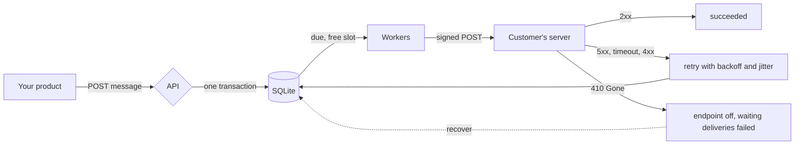

# Bowler

[](https://github.com/sungwoonpk/Bowler/actions/workflows/ci.yml)
[](https://github.com/sungwoonpk/Bowler/actions/workflows/codeql.yml)

A webhook delivery service. Your product says "this happened", and Bowler makes sure each of your customers' servers hears about it: it signs the request, retries failures, keeps one slow customer from holding up the others, and records exactly what happened on every attempt.

Written in Go. It runs as one static file, with no database server and no C compiler.


**Contents:** [Why](#why) · [Quick start](#quick-start) · [How it works](#how-it-works) · [Using the API](#using-the-api) · [For the customers who receive webhooks](#for-the-customers-who-receive-webhooks) · [Features](#features) · [Configuration](#configuration) · [Guarantees and limits](#guarantees-and-limits) · [Performance](#performance) · [Quality](#quality) · [Project layout](#project-layout) · [Roadmap](#roadmap)

## Why

Almost every product that has an API ends up sending webhooks, and almost every team builds the sending side too quickly and finds the problems later.

| What goes wrong                                              | What Bowler does                                                                                           |
| ------------------------------------------------------------ | ---------------------------------------------------------------------------------------------------------- |
| A customer's server is down and the event is lost            | The event is stored before you are told "accepted", and retried for about a day                            |
| One slow customer fills the workers and everyone waits       | Every endpoint has its own concurrency cap, so one stuck endpoint holds one worker, not all of them        |
| The same event arrives twice and a customer is charged twice | Every attempt carries the same `webhook-id`, so a receiver can ignore a repeat                             |
| "Is this really from you?"                                   | Signed as the open [Standard Webhooks](https://www.standardwebhooks.com) specification says, with rotation |
| A customer says "you never sent it"                          | A history of every attempt: when, the status, how long, and what the receiver answered                     |
| A customer fixes their server and has missed a day of events | One `recover` call replays failures and sends what arrived while the endpoint was off                      |
| A user registers `http://169.254.169.254/` as a webhook URL  | Refused when registered, and refused again at connection time, so DNS tricks do not work                   |
| The sending process is killed in the middle of a send        | Nothing is lost. Work is taken under a lease, and another worker picks it up when the lease runs out       |

## Quick start

Needs Go 1.26 or newer. Nothing else: no accounts, no keys, no network, no cost.

**See it work.** The demo starts the service and five "customers", each a small server on your machine that fails in its own way: one is healthy, one fails the first two tries of every message, one is down for five seconds, one hangs, and one answers `410 Gone`. It sends ten messages to all five and shows what happens, in about fifteen seconds. Each customer verifies the signatures the way a real one would. The recording above is a rendering of a real run, with its real timing.

```bash
git clone https://github.com/sungwoonpk/Bowler.git
cd Bowler
make demo
```

**Run the service.**

```bash
export BOWLER_API_KEY=$(openssl rand -hex 24)
go run ./cmd/bowler serve            # listens on 127.0.0.1:8080
```

Or with Docker:

```bash
export BOWLER_API_KEY=$(openssl rand -hex 24)
docker compose up --build
```

To send to a server on your own machine, start it with `--allow-private --allow-http`. Those flags are for development only. They switch off the protection against calling private addresses, so do not use them in production.

## How it works

Four words are used throughout:

| Word         | Meaning                                                                                    |
| ------------ | ------------------------------------------------------------------------------------------ |
| **App**      | One of your own customers. Everything below belongs to an app.                             |
| **Endpoint** | A URL that app wants events sent to, with its own signing secret, filter and limits.       |
| **Message**  | One event, such as `invoice.paid`, sent to every endpoint of the app that wants that type. |
| **Delivery** | One message going to one endpoint. It has attempts, and each attempt is recorded.          |



A message and its deliveries are stored in one transaction before the API answers `202`. Workers take due deliveries under a lease, sign and send them, and record the result. A `2xx` is success, `410 Gone` switches the endpoint off, and anything else is retried on a schedule that stretches over about a day.

## Using the API

The full description is [docs/openapi.json](docs/openapi.json). It covers every route and the webhook your customers receive, and a test fails if it drifts from the server.

**Set up an app and send a message:**

```bash
curl -s localhost:8080/v1/apps -H "authorization: Bearer $BOWLER_API_KEY" -H "content-type: application/json" \
  -d '{"name": "Acme", "uid": "acme-1"}'

curl -s localhost:8080/v1/apps/acme-1/endpoints -H "authorization: Bearer $BOWLER_API_KEY" -H "content-type: application/json" \
  -d '{"url": "https://hooks.example.com/bowler", "event_types": ["invoice.paid"], "concurrency": 3, "rate_limit_per_second": 20}'
# the response includes the signing "secret"

curl -s localhost:8080/v1/apps/acme-1/messages -H "authorization: Bearer $BOWLER_API_KEY" -H "content-type: application/json" \
  -H "Idempotency-Key: invoice-1042" \
  -d '{"event_type": "invoice.paid", "payload": {"invoice": "in_1042", "amount": 4200}}'
```

**Give an app's own side a token** that works on that app only, such as for a page where your customer manages its endpoints:

```bash
curl -s localhost:8080/v1/apps/acme-1/tokens -H "authorization: Bearer $BOWLER_API_KEY" -H "content-type: application/json" \
  -d '{"name": "customer portal", "scope": "read", "expires_in_hours": 720}'
# scope and expiry are optional. The response includes "token": "bwl_...", shown once. Only its hash is kept.

curl -s localhost:8080/v1/apps/acme-1/endpoints -H "authorization: Bearer bwl_..."    # works
curl -s -X POST localhost:8080/v1/apps/acme-1/endpoints -H "authorization: Bearer bwl_..." -d '{}'   # 403 read_only, this token is read only
curl -s localhost:8080/v1/apps/other-app/endpoints -H "authorization: Bearer bwl_..."  # 404, as if the app did not exist
curl -s localhost:8080/v1/apps/acme-1/audit-log -H "authorization: Bearer bwl_..."     # who did what
curl -s -X DELETE localhost:8080/v1/apps/acme-1/tokens/tok_... -H "authorization: Bearer $BOWLER_API_KEY"   # revoked at once
```

**After a customer fixes their server:**

```bash
curl -s -X POST localhost:8080/v1/apps/acme-1/endpoints/ep_.../recover -H "authorization: Bearer $BOWLER_API_KEY"
```

This switches the endpoint on, replays deliveries that failed in the last day, and sends the messages that arrived while it was off.

## For the customers who receive webhooks

Each request has three headers, and the body is exactly the payload you sent.

```
webhook-id:         msg_...            the message id, the same on every attempt
webhook-timestamp:  1731403200         when this attempt was made
webhook-signature:  v1,g0hM9Ss...      one or two signatures
```

A Go receiver verifies in one call. This is the tested example from the `signature` package:

```go
body, _ := io.ReadAll(r.Body) // read it before parsing: the signature covers these exact bytes
err := signature.Verify(
    []string{secret}, // pass the old secret too while one is being rotated
    r.Header.Get(signature.HeaderID),
    r.Header.Get(signature.HeaderTimestamp),
    r.Header.Get(signature.HeaderSignature),
    body, time.Now(), 0, // 0 means the default tolerance of five minutes
)
if err != nil {
    http.Error(w, "invalid signature", http.StatusBadRequest)
    return
}
// Ignore a webhook-id you have already handled, then do the work.
```

Receivers in other languages can use any Standard Webhooks library. Answer `2xx` to accept. Anything else is retried, except `410 Gone`, which switches the endpoint off. Because delivery is at least once, **ignore a `webhook-id` you have seen before**.

## Features

**Delivery**

- **Reliable.** At least once. Retries follow a schedule of about a day, with jitter, and honour `Retry-After`.
- **Isolated.** An endpoint has a concurrency (1 to 20). The queue takes only as many deliveries from an endpoint as it has free slots, so a backlog behind one slow receiver cannot starve the rest. [0005](docs/decisions/0005-isolation-and-recovery.md)
- **Rate limited.** An endpoint can also be limited to a number of attempts per second (1 to 1000). The limit is kept in the database, so a restart does not reset it. It applies to retries and to `recover`, so replaying a long outage does not flood a receiver that has just been fixed. [0007](docs/decisions/0007-per-endpoint-rate-limit.md)
- **Replayable.** Replay one delivery, or `recover` a whole endpoint.
- **Idempotent to send.** An `Idempotency-Key` makes retrying a request whose answer you never got safe.
- **A clear failure vocabulary.** Every failed attempt says why: `timeout`, `dns`, `connection_refused`, `tls`, `blocked_address`, `redirect`, `http_4xx`, `http_5xx`, `gone`, `rate_limited`.

**Security**

- **Signing.** `webhook-id`, `webhook-timestamp` and `webhook-signature`, as Standard Webhooks describes. Rotating a secret sends two signatures for a grace period, so receivers can switch without losing a message. The `signature` package has no dependencies. [0002](docs/decisions/0002-standard-webhooks-signing.md)
- **SSRF protection.** https only, and no private, loopback or metadata addresses, checked when a URL is registered and again on the address actually dialled. Redirects are not followed and proxies from the environment are ignored. [0003](docs/decisions/0003-ssrf-at-connection-time.md)
- **Encrypted signing secrets.** Set `BOWLER_ENCRYPTION_KEY` and the secrets are sealed with AES-256-GCM in the database file, so a copy of the file or a backup cannot forge webhooks. Turning it on, rotating the key and checking the key all happen in one pass at start. [0010](docs/decisions/0010-encrypted-signing-secrets.md)
- **Tokens for one app.** The operator's key can make a token for an app. It is shown once and only its hash is stored. It works on that app and no other, another app looks the same as one that does not exist, and it can be revoked at once. A token can be **read only** (it cannot change anything, nor read a signing secret) and can **expire**. That is what a page for your customers needs, since such a page cannot hold a key that reads everyone's data. [0009](docs/decisions/0009-app-tokens-and-audit-log.md)
- **An audit log.** Endpoint changes, token creation and revocation, every read or rotation of a signing secret, `recover` and replay are recorded with who did them (the operator, or a token), the resource and the request id. Updates list the fields changed, never the values.

**Data**

- **Retention.** Finished messages are deleted with their deliveries and attempts after 30 days, oldest first, in small transactions that never hold the queue up. A message that still has work to do is never deleted. The audit log has its own period, 365 days. [0008](docs/decisions/0008-retention.md)

**Operation**

- **Observable.** Structured JSON logs with request ids, Prometheus metrics, `/healthz` and `/readyz`.
- **Orderly shutdown.** It stops taking work, lets attempts finish for a drain time, and hands back what it cut off, uncounted. A `healthcheck` command serves containers with no shell.
- **Small.** One static binary of about 16 MB for Linux, macOS and Windows, and one SQLite file. The Docker image is distroless and runs as an unprivileged user. [0004](docs/decisions/0004-sqlite-single-binary.md)

## Configuration

Every setting is a flag and an environment variable, except the three keys, which are environment only so that they do not show in the process list. A flag beats the variable, which beats the default.

| Flag                | Environment              | Default            | Meaning                                                                                       |
| ------------------- | ------------------------ | ------------------ | --------------------------------------------------------------------------------------------- |
| _(none)_            | `BOWLER_API_KEY`         | required           | At least 24 characters. Environment only: a flag would show in the process list               |
| _(none)_            | `BOWLER_ENCRYPTION_KEY`  | off                | 32 bytes as base64 (`openssl rand -base64 32`). Seals the signing secrets in the database. Environment only |
| _(none)_            | `BOWLER_ENCRYPTION_KEY_PREVIOUS` | off        | The key being replaced, while rotating. Environment only                                      |
| `--addr`            | `BOWLER_ADDR`            | `127.0.0.1:8080`   | Where to listen. Use `0.0.0.0:8080` only behind a proxy                                       |
| `--db`              | `BOWLER_DB`              | `bowler.db`        | The SQLite file                                                                               |
| `--workers`         | `BOWLER_WORKERS`         | `128`              | Most deliveries in progress at once                                                           |
| `--timeout`         | `BOWLER_TIMEOUT`         | `15s`              | How long one attempt may take                                                                 |
| `--lease`           | `BOWLER_LEASE`           | timeout + 45s      | How long work taken by an instance that dies waits for another to take it                     |
| `--drain`           | `BOWLER_DRAIN`           | `10s`              | How long shutdown lets attempts finish                                                        |
| `--max-payload`     | `BOWLER_MAX_PAYLOAD`     | `262144`           | Largest message payload, in bytes                                                             |
| `--retention`       | `BOWLER_RETENTION`       | `720h` (30 days)   | How long finished messages and their history are kept. `0` for ever, otherwise at least `24h` |
| `--audit-retention` | `BOWLER_AUDIT_RETENTION` | `8760h` (365 days) | How long the audit log is kept. `0` for ever, otherwise at least `168h`                       |
| `--log-format`      | `BOWLER_LOG_FORMAT`      | `json`             | `json` or `text`                                                                              |
| `--log-level`       | `BOWLER_LOG_LEVEL`       | `info`             | `debug`, `info`, `warn` or `error`                                                            |
| `--allow-private`   | `BOWLER_ALLOW_PRIVATE`   | off                | Development only. Allows private and loopback addresses for every endpoint                    |
| `--allow-http`      | `BOWLER_ALLOW_HTTP`      | off                | Development only. Allows plain `http`                                                         |

## Guarantees and limits

| It promises                                                                                                    | It does not promise                                                                                          |
| -------------------------------------------------------------------------------------------------------------- | ------------------------------------------------------------------------------------------------------------ |
| A message that got `202` is not lost, even if the process is killed                                            | Exactly once. A crash or a slow answer can cause a repeat, so receivers must ignore a `webhook-id` they know |
| Every attempt is recorded, with its status, duration and failure reason                                        | A particular order. A retry can be overtaken by a newer message                                              |
| One endpoint cannot use more than its concurrency of the workers, or start attempts faster than its rate limit | That a receiver is reachable. A receiver on a private network needs the development flag                     |
| Secrets, tokens and API keys are never written to the log or the audit log                                     | Encryption of payloads. Only signing secrets are encrypted, and only if you set a key                        |
| Finished data is deleted after the retention period                                                            | That the file gets smaller. Deleted space is reused, and shrinking the file needs a `VACUUM`                 |

What this version does not do:

**Security and access**

- The operator's API key can do everything, and the audit log shows it only as `admin`, so people who share it cannot be told apart.
- A full token has the whole authority of its app. A token can be read only or can expire, and there is nothing in between. When it was last used is recorded only to within ten minutes.
- The audit entry is written after the action, not in the same transaction. A failed write is logged and counted in `bowler_audit_errors_total`, and the entry is missing.
- Without `BOWLER_ENCRYPTION_KEY`, signing secrets are stored in the clear. With it, the key is in the running program's environment, so it protects a copy of the file and not a person on the machine, and if the key is lost the secrets are lost.
- Payloads and the start of each receiver's reply are never encrypted. They are deleted after the retention period, but until then they are in the clear, so use an encrypted volume.
- No TLS and no rate limit on the API itself. Put it behind a proxy. The per-endpoint rate limit protects receivers, not the API.
- A receiver on a private network cannot be reached without the global development flag, which removes the SSRF protection. There is no per-endpoint allow list yet.
- HMAC signatures only. The specification's asymmetric `v1a` scheme is not implemented.

**Behaviour**

- An idempotency key stops protecting once its message is deleted by retention.
- A rate limit allows a burst of one second's worth after a quiet time, and holds the rate on average, to within the 250 ms poll.
- At least once, not exactly once, and no ordering guarantee.

**Scale and scope**

- One node. SQLite has one writer and one file, and there is no replication, so back the file up.
- No interface for your customers. It is an API. Tokens make such a page possible, and the page itself is not built.
- The Docker image is built and checked by CI, and has not been built by hand on the author's machine.
- Demo grade. It has had no independent security review.

The threat model, [docs/threat-model.md](docs/threat-model.md), lists what is protected, from whom, how, and what is not covered. [SECURITY.md](SECURITY.md) says how to report a problem and how to deploy safely.

## Performance

Measured with `go test ./internal/dispatcher -bench . -benchtime 2000x`, on an Apple M3 Pro, one process, one SQLite file on the local disk. Each message goes to ten endpoints. The numbers cover the whole path: storing the message, taking the work, sending, recording the result.

| What is measured                                             | Result                                              |
| ------------------------------------------------------------ | --------------------------------------------------- |
| The queue and database alone (a sender that answers at once) | about 6,800 to 7,400 deliveries a second            |
| Real signed HTTP requests over the loopback interface        | about 5,700 to 6,300 deliveries a second, four runs |
| Cost of choosing work, 1,000 to 50,000 deliveries waiting    | about 0.2 ms, the same at every size                |

These are from one laptop on loopback. They show where the limits are, and are not a promise about your hardware or your customers' servers. The machine varies from hour to hour, so only a comparison made in one sitting means much.

**What measuring found.** Each of these only shows when the service is busy, and each now has a test or a record behind it.

- **A backlog made the queue slower.** Choosing work ranked every due delivery, so one claim took 2 ms with 1,000 waiting and 190 ms with 50,000, and a service that fell behind fell further behind. It now reads one endpoint at a time through partial indexes, and a test fails if the cost grows with the backlog.
- **Half of all requests opened a new connection.** The HTTP client kept four idle connections per host while an endpoint may run twenty deliveries at once. Under load that used up local ports, and throughput swung between 27 and 4,200 deliveries a second. New connections fell from about 500 to about 19 per thousand deliveries.
- **Every result was its own transaction**, and a commit is most of the cost of a small write. A writer now records results that arrive together in one transaction, each with its own savepoint so one bad result cannot spoil the rest. Run back to back in one sitting, that took the queue from about 4,000 to 4,900 up to about 6,300 to 6,900 deliveries a second, and real HTTP from about 5,000 to 5,800 up to about 7,500 to 7,900. [0006](docs/decisions/0006-batched-result-writes.md)

The ceiling is still SQLite's single writer, only higher. Moving to a networked database is on the roadmap.

## Quality

```bash
make check       # format, vet, staticcheck, errcheck, gosec, race tests with coverage, vulnerabilities
```

- **236 tests** run with the race detector, and the libraries have **92% coverage**. CI fails under 85%.
- **A test that kills the real program.** It starts `bowler serve` as a separate process, sends twenty messages to a receiver that holds its requests open, waits until deliveries are in flight, kills the process with `kill -9`, starts it again on the same database, and checks that every message reaches the customer.
- **Concurrency.** Twelve workers share one queue and each delivery is handed out exactly once. Three dispatchers share a queue and nothing is sent twice. A slow endpoint with two hundred deliveries behind it does not delay a healthy one.
- **Failure handling.** Every status class, timeouts, refused connections, DNS failures, bad certificates, redirects, a reply that never ends, a sender that panics, a lease that is lost, shutdown mid-attempt.
- **Security.** Every kind of private address, a name that resolves to loopback, `HTTP_PROXY` ignored, the API key never in the log, one app unable to read another's data. One test walks every route the server registers and checks that a token of one app cannot reach another, and that the operator-only routes refuse tokens.
- **The documentation is tested.** The signing example is compiled and run. The OpenAPI file is compared with the routes the server registers, and with the server's behaviour for tokens, route by route.
- **The tests were tested.** Important ones were checked by breaking the code or the spec on purpose and confirming the test fails. A test that passes the first time proves little.
- **CI** runs all of that, plus a scan for known vulnerabilities, CodeQL, builds for Linux, macOS and Windows, the demo with its output checked, and a container that must become healthy, run as an unprivileged user and stop cleanly.

## Project layout

```
Bowler/
├── cmd/bowler/           serve, demo, healthcheck, version
├── signature/            Sign and Verify, public, no dependencies
├── retry/                the retry schedule, public, no dependencies
├── internal/
│   ├── store/            the database and the queue: leases, fairness, replay, recovery
│   ├── dispatcher/       runs the queue, writes results in batches, shuts down in order
│   ├── retention/        deletes finished data and old audit entries after their retention periods
│   ├── token/            makes app tokens and the hashes that are stored
│   ├── secretbox/        seals signing secrets with a key from outside the database
│   ├── deliver/          one attempt, and a verdict
│   ├── ssrf/             which addresses may be called
│   ├── api/              the HTTP interface, one file per resource
│   ├── domain/           the things Bowler is about
│   └── id/               identifiers
├── docs/                 openapi.json, threat model, decision records, images
├── Dockerfile, docker-compose.yml, Makefile
└── .github/              CI, CodeQL, Dependabot
```

**Design decisions** are written down in [docs/decisions](docs/decisions), each with what it costs:

| #    | Decision                                                                                                                         |
| ---- | -------------------------------------------------------------------------------------------------------------------------------- |
| 0001 | [Delivery is at least once, and a lease decides who works on a delivery](docs/decisions/0001-at-least-once-with-leases.md)       |
| 0002 | [Webhooks are signed as the Standard Webhooks specification says](docs/decisions/0002-standard-webhooks-signing.md)              |
| 0003 | [Customer URLs are checked when registered and again when a connection is made](docs/decisions/0003-ssrf-at-connection-time.md)  |
| 0004 | [One SQLite file and one static binary](docs/decisions/0004-sqlite-single-binary.md)                                             |
| 0005 | [One receiver cannot hold up the rest, and a receiver that is fixed can catch up](docs/decisions/0005-isolation-and-recovery.md) |
| 0006 | [Results are written in batches by one writer](docs/decisions/0006-batched-result-writes.md)                                     |
| 0007 | [An endpoint can be limited to a number of attempts per second](docs/decisions/0007-per-endpoint-rate-limit.md)                  |
| 0008 | [Finished data is deleted after a retention period](docs/decisions/0008-retention.md)                                            |
| 0009 | [An app can be given a token that works on that app only, and what is done is recorded](docs/decisions/0009-app-tokens-and-audit-log.md) |
| 0010 | [Signing secrets are encrypted in the database when a key is given](docs/decisions/0010-encrypted-signing-secrets.md) |

Contributing is described in [CONTRIBUTING.md](CONTRIBUTING.md).

## Roadmap

1. Postgres, and more than one node
2. A retention period per app, and encrypting payloads
3. Named operator credentials, and the audit entry in the same transaction as the change
4. A page for your customers to manage endpoints and read their delivery log, using tokens
5. Wake the dispatcher exactly when a rate limit allows more, instead of on the next poll
6. Asymmetric `v1a` signatures, and a per-endpoint allow list for private receivers
