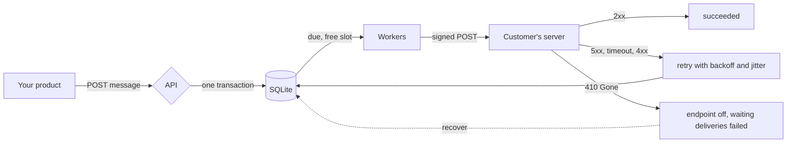

# Architecture

## How it works

Four words are used throughout:

| Word         | Meaning                                                                                    |
| ------------ | ------------------------------------------------------------------------------------------ |
| **App**      | One of your own customers. Everything below belongs to an app.                             |
| **Endpoint** | A URL that app wants events sent to, with its own signing secret, filter and limits.       |
| **Message**  | One event, such as `invoice.paid`, sent to every endpoint of the app that wants that type. |
| **Delivery** | One message going to one endpoint. It has attempts, and each attempt is recorded.          |



A message and its deliveries are stored in one transaction before the API answers `202`. Workers take due deliveries under a lease, sign and send them, and record the result. A `2xx` is success, `410 Gone` switches the endpoint off, and anything else is retried on a schedule that stretches over about a day.

## Project layout

```
Bowler/
├── cmd/bowler/           serve, demo, healthcheck, version
├── signature/            Sign and Verify, public, no dependencies
├── retry/                the retry schedule, public, no dependencies
├── internal/
│   ├── store/            the database and the queue: leases, fairness, replay, recovery
│   ├── dispatcher/       runs the queue, writes results in batches, shuts down in order
│   ├── retention/        deletes finished data and old audit entries after their retention periods
│   ├── token/            makes app tokens and the hashes that are stored
│   ├── secretbox/        seals signing secrets with a key from outside the database
│   ├── deliver/          one attempt, and a verdict
│   ├── ssrf/             which addresses may be called
│   ├── api/              the HTTP interface, one file per resource
│   ├── domain/           the things Bowler is about
│   └── id/               identifiers
├── docs/                 openapi.json, threat model, decision records, images
├── Dockerfile, docker-compose.yml, Makefile
└── .github/              CI, CodeQL, Dependabot
```

The reasons behind the main choices are in [decisions](decisions/README.md).
